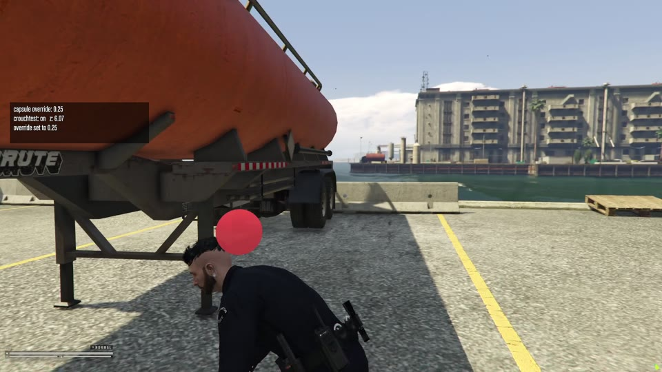

# fivem-ped-capsule-height-test

A small client resource for testing `SET_PED_CAPSULE_HEIGHT_OVERRIDE` and `CLEAR_PED_CAPSULE_HEIGHT_OVERRIDE`, natives proposed in
[citizenfx/fivem#4316](https://github.com/citizenfx/fivem/pull/4316) that lower a
ped's mover capsule (its collision with the world), so a crouching ped can move under things like a trailer.

It needs a FiveM client built from the PR branch. On official clients, the natives don't exist yet.

*Crouching under a fuel tanker with the override at `0.25`, then standing back up ([video](media/demo.mp4)).*

## Setup

1. Build the FiveM client from the PR branch (see [`docs/building.md`](https://github.com/citizenfx/fivem/blob/master/docs/building.md)).
2. Put this folder in your server's `resources` and run `ensure fivem-ped-capsule-height-test` (or add it to your `server.cfg`).
3. Connect with the dev client, open the **F8** console and run the commands below.

The current override and the last result are shown in an on-screen box, and a red marker shows the top of each
overridden capsule (your own, and other players' when shared with `capsync`).

## Commands

| Command | Does |
|---|---|
| `cap <height>` | Override the top of the capsule, in meters above the ped's position (the default is about `0.82`) |
| `cap 0` | Remove the override (`CLEAR_PED_CAPSULE_HEIGHT_OVERRIDE`) |
| `crouchtest` | Toggle a crouch walk (`move_ped_crouched`) together with an override of `0.25`, the game's own crouched height |
| `capsync` | Toggle sharing your override through your player state bag, so other clients apply it to your ped. Only needed on servers that don't sync the override yet (see below) |

The natives are called through `Citizen.InvokeNative` (`0x62A2D8E3` and `0x85A6FDA3`), since dev builds don't regenerate the Lua
native bindings.

## Syncing

The override is synced to other players along with the ped, on servers that announce net version 6 (servers built
from the PR). On other servers it only applies locally, and `capsync` shows how to share it through a state bag
instead.

## Test checklist

| Step | Expected |
|---|---|
| Walk into a low obstacle, such as the underside of a fuel tanker trailer | Blocked, as usual |
| `crouchtest`, then walk under it | The ped moves under the trailer |
| `crouchtest` again, away from the trailer | The ped stands up, and is blocked by the trailer again |
| `cap 0.4`, `cap 1.2`, `cap 0` | The marker moves with the override, and collision follows it |
| `crouchtest` under the trailer, `disconnect` and rejoin | The override is gone |
| With a second client, on a server built from the PR: `crouchtest` on client 1, then drop onto client 1 from client 2 | Client 2 lands at client 1's crouched height: the override is synced with the ped |
| `crouchtest` again on client 1 | Client 2 is back on client 1's full-height capsule |
